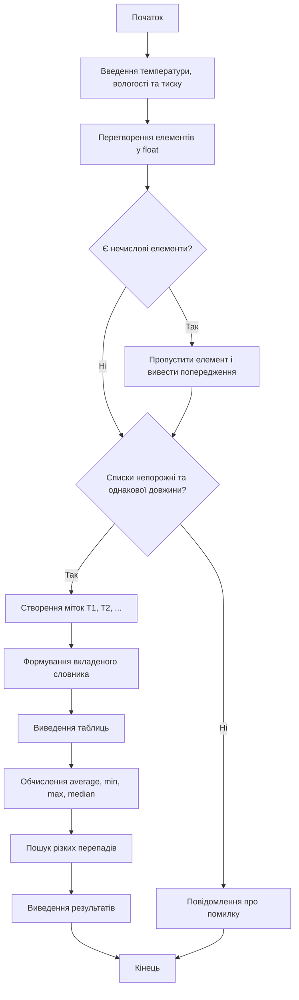
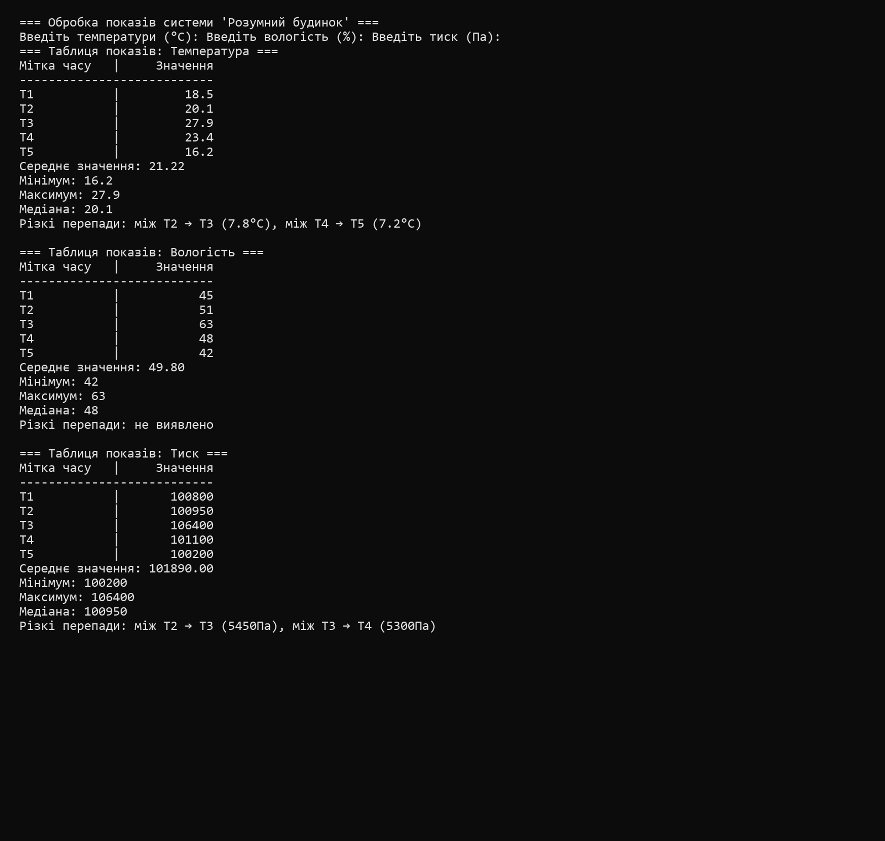

# Лабораторна робота №2
# Виконав студент групи: ІКМ-724в
# Матвейчук С. В.
## Використання підпрограм, модулів та пакетів у мові Python

### Мета роботи

Ознайомитися зі способами створення та використання підпрограм, модулів і пакетів у Python. Навчитися структурувати програму шляхом поділу її на функціональні частини, використовувати стандартний модуль `statistics` та обробляти помилки введення за допомогою конструкції `try-except`.

---

## 1. Опис завдання

Необхідно створити програму для статистичної обробки показів температури, вологості та атмосферного тиску системи «Розумний будинок».

Користувач вводить три рядки чисел. Програма повинна:

- перетворити введені значення у числа та пропустити нечислові фрагменти;
- перевірити однакову кількість вимірювань;
- сформувати вкладений словник із часовими мітками `T1`, `T2`, `T3` та наступними;
- обчислити середнє значення, мінімум, максимум і медіану;
- знайти різкі перепади між сусідніми вимірюваннями;
- вивести відформатовані таблиці та результати;
- реалізувати обчислення спочатку у власному модулі, а потім у пакеті `sensors`.

Порогові значення перепадів:

- температура — понад 7 °C;
- вологість — понад 20 %;
- тиск — понад 5000 Па.

---

## 2. Структура проєкту

```text
lab02_Python/
├── lab02_modules/
│   ├── lab02_main.py
│   └── stats_module.py
├── lab02_package/
│   ├── lab02_main.py
│   └── sensors/
│       ├── __init__.py
│       └── stats_module.py
├── tests/
│   └── test_lab02.py
├── lab02_report_Matveichuk_Stanislav_724_b.docx
├── screen.png
└── README.md
```

У каталозі `lab02_modules` виконано завдання з власним модулем. У каталозі `lab02_package` ті самі функції оформлено як пакет `sensors`. Файл `__init__.py` визначає публічний інтерфейс пакета.

---

## 3. Алгоритм роботи програми

1. Вивести заголовок програми.
2. Отримати від користувача температури, вологість і тиск.
3. Розділити кожен рядок за пробілами.
4. Перетворити елементи на `float` у блоці `try-except`.
5. Пропустити нечислові елементи з попередженням.
6. Перевірити, що списки не порожні та мають однакову довжину.
7. Створити часові мітки `T1`, `T2`, `T3` та сформувати вкладений словник.
8. Для кожного виду показників вивести таблицю.
9. Обчислити середнє значення, мінімум, максимум і медіану.
10. Порівняти сусідні вимірювання та знайти перепади, що перевищують поріг.
11. Вивести результати або повідомлення про відсутність перепадів.

### Алгоритм мовою Mermaid



---

## 4. Реалізовані функції

### Модуль `stats_module.py`

- `get_average(data_dict)` — повертає середнє арифметичне або `None`;
- `get_min(data_dict)` — повертає мінімальне значення або `None`;
- `get_max(data_dict)` — повертає максимальне значення або `None`;
- `get_median(data_dict)` — повертає медіану або `None`;
- `find_jumps(data_dict, threshold)` — повертає список різких перепадів;
- `show_table(data_dict, title)` — виводить відформатовану таблицю.

### Основна програма `lab02_main.py`

- `parse_input(input_str)` — перетворює рядок на список чисел;
- `create_data_dict(...)` — створює словник показників із мітками часу;
- `process_measurements(...)` — виводить таблицю, статистику та перепади;
- `main()` — керує введенням, перевіркою та обробкою даних.

Повний код розміщено у файлах:

- [Завдання 1 — головна програма](lab02_modules/lab02_main.py)
- [Завдання 1 — власний модуль](lab02_modules/stats_module.py)
- [Завдання 2 — головна програма](lab02_package/lab02_main.py)
- [Пакет sensors](lab02_package/sensors/__init__.py)
- [Модуль пакета sensors](lab02_package/sensors/stats_module.py)
- [Автоматичні тести](tests/test_lab02.py)

---

## 5. Запуск програми

### Завдання 1 — власний модуль

```bash
cd lab02_modules
python lab02_main.py
```

### Завдання 2 — пакет

```bash
cd lab02_package
python lab02_main.py
```

### Автоматичні тести

Із кореня репозиторію:

```bash
python -m unittest discover -s tests -v
```

---

## 6. Тестування програми

### Тест 1. Коректні дані та різкі перепади

Вхідні дані:

```text
Температура: 18.5 20.1 27.9 23.4 16.2
Вологість:   45 51 63 48 42
Тиск:        100800 100950 106400 101100 100200
```

Основні результати:

```text
Середня температура: 21.22
Мінімальна температура: 16.2
Максимальна температура: 27.9
Медіана температури: 20.1

Різкі перепади температури:
між T2 → T3 (7.8°C)
між T4 → T5 (7.2°C)

Різкі перепади тиску:
між T2 → T3 (5450 Па)
між T3 → T4 (5300 Па)
```

### Тест 2. Нечисловий фрагмент

```text
Вхід: 18.5 помилка 20.1
Результат: значення «помилка» пропущено з попередженням.
```

### Тест 3. Різна кількість показників

```text
Помилка: кількість значень не збігається.
```

### Тест 4. Порожній ряд

```text
Помилка: кожен ряд вимірювань має містити хоча б одне число.
```

### Результат автоматичних тестів

```text
test_custom_module ... ok
test_sensors_package ... ok

Ran 2 tests
OK
```

---

## 7. Висновок

Під час виконання лабораторної роботи було створено дві реалізації програми статистичної обробки показників системи «Розумний будинок».

У першому завданні функції обчислення статистичних характеристик розміщено у власному модулі `stats_module.py`. У другому завданні ці функції оформлено як пакет `sensors` із публічним інтерфейсом у файлі `__init__.py`.

У процесі роботи було використано функції, вкладені словники, модулі, пакети, імпорт, стандартний модуль `statistics`, форматування рядків та обробку помилок за допомогою `try-except`. Автоматичні тести підтвердили однакову правильну роботу обох реалізацій.

У результаті було закріплено навички структурної організації програм Python та повторного використання коду.

## Приклад виведення програми



## Звіт

Оформлений звіт у форматі Word: [lab02_report_Matveichuk_Stanislav_724_b.docx](lab02_report_Matveichuk_Stanislav_724_b.docx)
